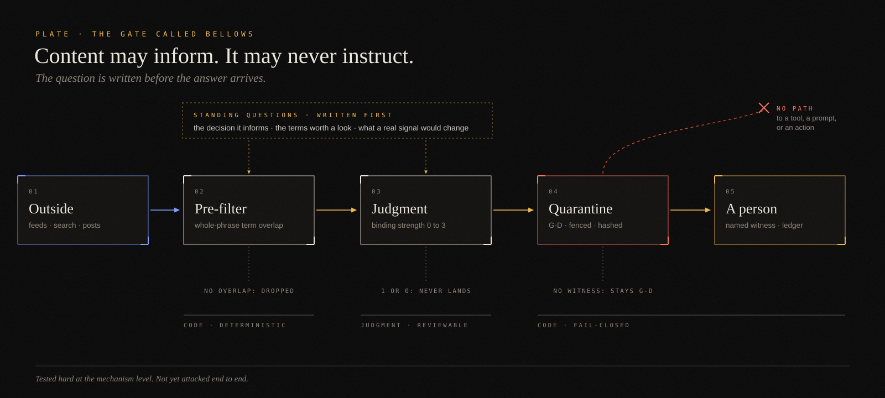

# Bellows



Every useful agent reads the outside world: search results, pages, newsletters, papers, other agents' messages. Any of it can carry instructions. Bellows is the Kingdom's answer to one narrow part of that problem. It doesn't try to make outside content trustworthy. It makes sure outside content can never *become authority*.

It works in two moves. First, the question comes before the answer. A **watch** is a standing question written at decision time: which decision it informs, the terms that would make something worth a look, and what a real signal would change. Content that doesn't overlap a live watch is dropped. Second, anything that does land is **quarantined**. It arrives at grade G-D (narrated, untrusted), every outside field sits inside one sanitized fence under a banner that says *data, not instructions*, and the bytes are hashed. The only way out is a promotion: a person decides, and the record shows who and when.

Between those two moves sits a judgment: how strongly does this bear on the watch? 3 means it hits the watch's specific object, 2 means the topic but not the object, and 1 or 0 never lands. When unsure, score down. A wrong signal erodes trust faster than a missed one. The code never assigns that score; a term hit only makes something a candidate.

## Run it

Python 3.9 or newer, standard library only.

```bash
cd crafts/03-sensing/bellows
mkdir -p /tmp/bellows-demo && cp fixtures/watches.json /tmp/bellows-demo/
python3 bellows.py --root /tmp/bellows-demo candidates --signals fixtures/signals.json
python3 bellows.py --root /tmp/bellows-demo land --fires fixtures/fires.json
python3 bellows.py --root /tmp/bellows-demo land --fires fixtures/hostile_fires.json
python3 bellows.py --root /tmp/bellows-demo status
python3 -m unittest discover -s tests -v
```

Open the card in `/tmp/bellows-demo/quarantine/` that came from `hostile_fires.json`. The fixture tries to close the fence early, claim admin mode, run a command, and promote itself. All of it is still inside the fence, inert. The command is a harmless placeholder. And if you can't get a card promoted, read the promotion rule again. That one's on purpose.

## Files

- `bellows.py`: the pre-filter, landing, quarantine, promotion and run log.
- `fixtures/`: three sample watches (one closed), four signals (two should be dropped, including a "reagent" story that must not match "agent"), a clean fire, and a hostile one.
- `tests/test_bellows.py`: boundary matching, closed watches, dedup, the score floor, the honest "no signal" log, hash sidecars, tamper refusal, refused self-promotion, and a **twin**: the same card rendered without sanitizing, kept only to prove the fence test actually catches an escape.

## What's proven, and what isn't

**Status: Built, not exercised.** The Kingdom's own version has been proven piece by piece, not yet attacked as a chain: the matcher and the quarantine-with-a-twin checks are part of its proof suite, and the intake was refit and proved across several houses. This public rewrite carries the same checks in small form.

It has **not** been attacked end to end. Chains where ordinary tool choices compose into a boundary crossing (a redirect to an archive to a decoder to a second stage), module shadowing, detached child processes, and an outside attacker who adapts are all untested here. Bellows also only guards the content it handles. An agent that browses on its own, outside Bellows, is outside this protection. That gap is the subject of its essay, on the Kingdom tour.

None of these ideas are new. Standing queries, quarantined readers and "untrusted input never mints authority" are well-established patterns. This is one practitioner's small, working version of them.
